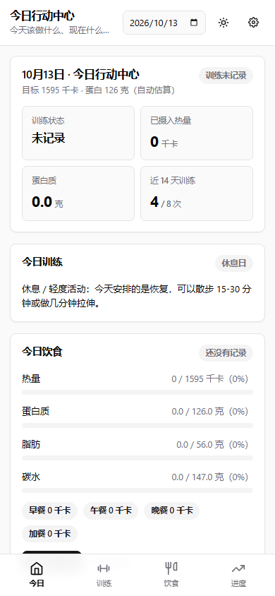
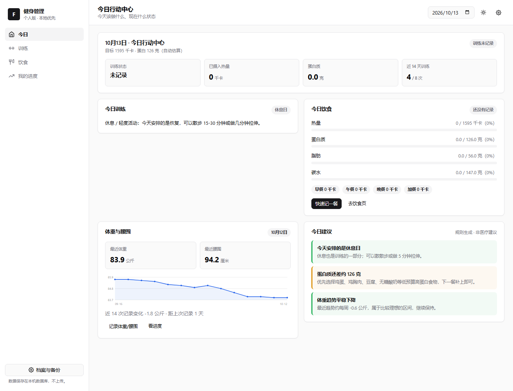
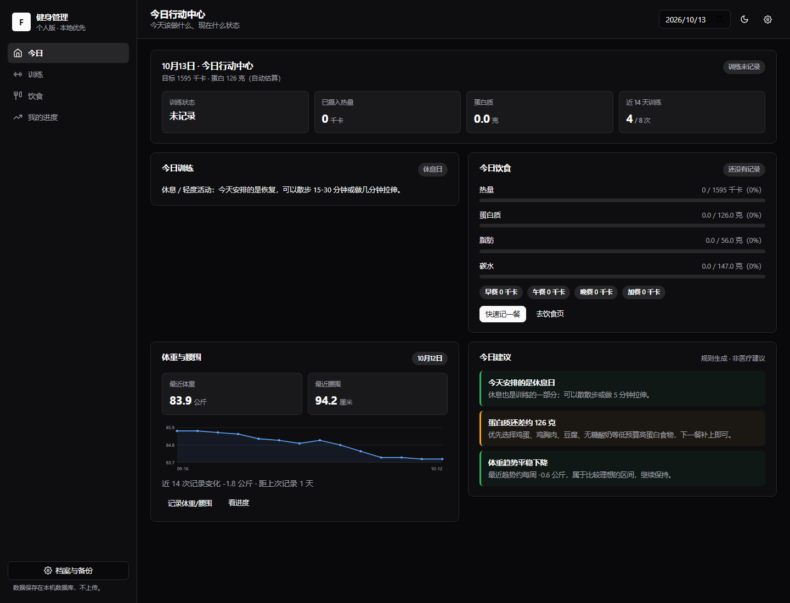

# Personal Fitness Management System

Project stage: 第一版已实现并跑通（后端 + 前端 + 数据持久化 + 自动化测试均在本机实际运行通过）。

> **在线体验**：https://personal-fitness-manager.app.workbuddy.host/
> （云端运行，无需安装；演示数据可在「档案与备份」中一键载入）

<p align="center">
  &nbsp;&nbsp;
  <br/>
  <sub>移动端今日行动中心 ｜ 桌面端浅色主题</sub>
  <br/><br/>
  
  <br/>
  <sub>桌面端深色主题</sub>
</p>

## Goal
Build a useful, mobile-first responsive personal fitness web app while learning AI-assisted full-stack development.

## 快速开始
```bash
npm install     # 只安装 express 一个依赖
npm start       # 启动服务，默认 http://127.0.0.1:3100
```
打开浏览器访问 http://127.0.0.1:3100 。停止服务：Ctrl + C。

其他命令：
```bash
npm run test            # 57 项测试（单元 + 集成）
npm run test:unit       # 仅单元测试（38 项）
npm run test:integration# 仅集成测试（19 项）
npm run smoke           # 服务启动后另开终端执行，检查关键接口（8 项）
```

配置：复制 `.env.example` 为 `.env` 后可改 `PORT`、`HOST`、`DATA_DIR`、`LOG_LEVEL`（`.env` 不会被提交）。

## 手机访问（同一 WiFi）

项目根目录的 `.env` 里把 `HOST` 设为 `0.0.0.0`（当前已设置好），然后 `npm start`。

启动后控制台会**自动打印**手机能用的网址，例如：

```
  本机访问： http://127.0.0.1:3100
  手机访问（需与电脑连同一个 WiFi）：
    http://10.58.134.91:3100
```

也可以随时在网页右上角齿轮 ⚙「档案与备份 → 访问方式」里看到同样的地址。

**手机上连不上怎么办 —— 90% 是 Windows 防火墙拦了。** 解决方法（任选其一）：

- 简单办法：第一次访问时 Windows 会弹「是否允许访问」的窗口，点**允许访问**即可。
- 手动放行（管理员身份打开 PowerShell，只放行本机这一个端口，比关防火墙安全）：
  ```powershell
  New-NetFirewallRule -DisplayName "Fitness App 3100" -Direction Inbound -LocalPort 3100 -Protocol TCP -Action Allow
  ```
- 其他排查：手机要用 **WiFi**（不能开流量/VPN）；地址里的 `http://` 不能省；端口要和控制台显示的一致。

> ⚠️ 安全提醒：开启后，同一个 WiFi 下的任何人都能打开这个应用（当前版本没有登录密码）。
> 在公司、学校、咖啡厅等公共网络，请把 `.env` 里的 `HOST` 改回 `127.0.0.1` 并重启。

## 技术栈

**前端**（浏览器里跑的部分）
- 原生 HTML + 原生 JavaScript ES 模块，**零构建**（改完代码刷新页面就生效，不需要 `npm run build`）
- 原生 CSS：用 CSS 变量做设计系统（配色/圆角/间距/阴影集中定义），视觉规范参照 shadcn/ui
- 界面风格：shadcn/ui 主题 token + 线性 SVG 图标（lucide 风格）+ 支持浅色/深色模式自动切换
- 图表：自写 SVG 折线图/柱状图（`public/js/charts.js`），不引第三方图表库
- 路由：hash 路由（`#/home`、`#/training` 等），无框架

**后端**（电脑上跑的服务）
- Node.js 22 + Express 4，唯一第三方依赖
- 分层结构：`routes`（接口）→ `services`（业务逻辑）→ `repositories`（数据库读写）
- 数据库：Node 22 内置 `node:sqlite`，数据文件 `data/fitness.db`（已加入 .gitignore）
- 配置：`.env` 文件 + 环境变量，启动时校验
- 日志：结构化 JSON 日志

**测试**
- Node 内置 `node:test`：38 项单元测试 + 19 项集成测试
- `scripts/smoke.js`：服务启动后的接口冒烟检查（8 项）

**为什么不用 shadcn/ui 官方版？**
官方版需要 React + Tailwind + Vite 构建工具，会把项目从「改完刷新就能看」变成「每次都要打包」。
这里保留了零构建架构，用原生 CSS 复刻它的设计 token（配色、圆角、间距、组件质感才是"好看"的来源），
维护成本和上云难度都低得多。

**成本**：零付费依赖。营养计算、目标推算、训练调整全部是确定性代码，**不依赖任何 AI 服务**，断网也能用。

## API Key 怎么给程序（不要发给任何人）

密钥**绝对不要**粘贴到聊天框、代码文件或前端里。本项目采用「程序自己读文件」的方式：

1. 把密钥单独存成一个文本文件（例如 `C:\Users\你的用户名\.ai_keys\glm.key`），文件内容只有一行密钥。
2. 在 `.env` 里告诉程序「**环境变量名**」，程序在运行时自己去那个环境变量指向的路径读文件：
   ```env
   AI_API_KEY_FILE_ENV=GLM_KEY_PATH
   ```
   其中 `GLM_KEY_PATH` 是你在系统环境变量里设的**变量名**，它的**值**是密钥文件的路径。
3. 重启服务后访问 http://127.0.0.1:3100/api/settings/ai-status 验证，会看到类似：
   ```json
   { "configured": true, "source": "AI_API_KEY_FILE（密钥文件）", "maskedKey": "sk************ef" }
   ```
   只显示前 2 后 2 位，**看不到也拿不到密钥原文**。

安全约定：密钥只在服务端内存中存在，不写日志、不返回原文、不下发给浏览器；`.env` 与密钥文件都不进版本库。
另外也支持直接把路径写进 `.env`：`AI_API_KEY_FILE=C:\路径\glm.key`（不如上面那种方式安全，但更简单）。

**说明**：当前第一版的所有功能都不需要密钥 —— 营养计算、目标推算、训练调整建议都是确定性代码。
密钥是给后续接大模型（如智谱 GLM）预留的通道，先把管道铺好，等你真正要用时直接配即可。

## First-version 已实现
- 今日行动中心：训练状态、热量与宏量进度、体重趋势、规则生成的建议、快速记录。
- 训练：一周计划生成、7 天切换、快速/明细记录、历史、规则化调整建议（可一键应用）。
- 饮食：按餐次记录、份量改动自动重算、目标对比、建议菜单模板、常用食物与食谱管理。
- 进度：体重/腰围趋势与每周变化、训练依从（区分"未记录"与"没练"）、饮食覆盖率、测量记录管理。
- 档案与备份：目标自动估算/手动覆盖、JSON 备份导出与恢复（需二次确认）、合成演示数据载入。

## Scope boundaries
- Personal use first; no mandatory login.
- No cloud sync or multi-user support.
- Food-photo recognition, camera exercise recognition, live voice coaching, complex AI personalization, and multi-user accounts are deferred.
- Core records/calculations work without external AI.
- Use synthetic test data; do not commit real health data.

## Start here
1. Read `AGENTS.md`.
2. Read `docs/PRD.md`, `docs/UI_UX_SPEC.md`, and `docs/PROJECT_STATUS.md`.
3. Inspect the actual workspace before modifying anything.
4. Build an end-to-end runnable first version, not static-only mockups.
5. Run tests and update status, development log, and handoff with verified results.

## Docs
See `docs/` for product requirements, UI/UX, status, chat handoff, software tests, Evaluation, and development history.
